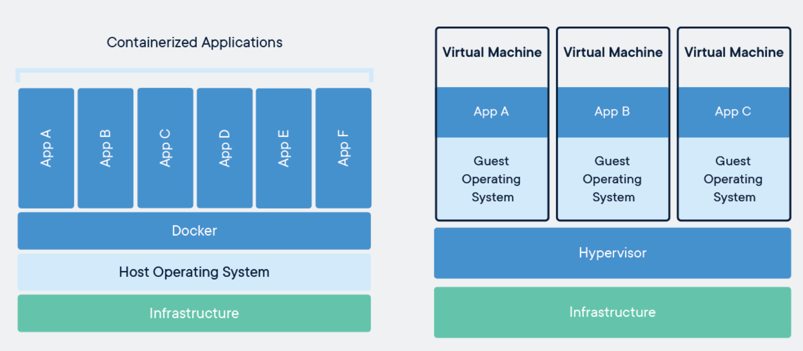

## Prologue: CNF

그래서 CNF가 뭐냐라고 하면 컨테이너가 좀 중요한 것 같음.

그래서 VM이랑 컨테이너의 차이를 좀 알아보자

---

## 1. Virtual Machine (VM)

VM은 우선 뭐 잘 알다시피 물리 서버를 하나의 컴퓨터처럼 쓴다는건데

구조는 하이퍼바이저(ex. VMware ESXi) 위에 VM을 띄우고, 각 VM 별로 OS를 띄운다는거임

### VM의 구조

- Physical Server
  - Hypervisor
    - VM 1: Guest OS + Application
    - VM 2: Guest OS + Application
    - VM 3: Guest OS + Application

각 VM은 독립적이기 때문에 서로 다른 OS를 실행할 수도 있음 

ESN에서는 VMware 기반 VM에 Rocky Linux 9을 올려서 운영했음

**장점**
- 독립적인 OS 환경 제공
- 서로 다른 운영체제 실행 가능
- 때문에 각각 격리된 환경을 구성 가능

**단점**
- 각 VM마다 OS를 실행해야 함 - 추가 리소스 필요
- OS 부팅 시간 必

그래서 실제로 ESN 할때처럼 OS 영역의 네트워크 / 디스크 파티셔닝 / 방화벽 / 어플리케이션 설치 등 할게 많음

물론 Ansible 사용해서 자동화시키면 되는데 지난 1년 반 동안 고생했던거 생각하면 솔직히 쉬운 작업은 아니었던 것 같음

---

## 2. Container

컨테이너는 VM과 다르게 컨테이너 별로 Guest OS 커널을 실행하지 않음

어플리케이션별로 필요한 라이브러리 / 설정등을 각각 격리된 환경에서 실행함

Linux 컨테이너는 Host OS의 커널을 공유함

### Container의 구조

- Physical Server
  - Host OS
    - Container Runtime
      - Container 1: Application + Dependencies
      - Container 2: Application + Dependencies
      - Container 3: Application + Dependencies

컨테이너는 별도의 커널을 부팅하지 않기 때문에 VM보다 빠르게 시작하고, 추가 리소스 사용량도 적음

여기서 중요한 Linux 기술이 두 가지 있음

**Namespace**

프로세스 / 네트워크 / 마운트 지점 등 시스템 자원을 분리해서, 컨테이너 내부에서 독립된 환경처럼 보이게 하는 기능

-> 말이 참 어렵다

**Cgroups (Control Groups)**

프로세스가 사용하는 CPU, 메모리 등의 리소스를 관리 / 제한하는 기능

즉, 컨테이너는 새로운 OS를 하나 더 띄우는 게 아니라 기존 Linux 커널의 기능을 이용해 격리된 실행 환경을 만드는 것에 가까움

---

## 3. VM vs Container

| 구분 | VM | Container |
|---|---|---|
| 가상화 대상 | 하드웨어 | OS 수준 |
| OS | VM마다 Guest OS | 호스트 커널 공유 |
| 실행 속도 | OS 부팅 필요 | 일반적으로 빠름 |
| 리소스 사용 | 상대적으로 많음 | 상대적으로 적음 |
| 격리 | 하이퍼바이저 기반 | 커널 기능 기반 |
| 배포 단위 | VM 이미지 | 컨테이너 이미지 |
| 대표 기술 | VMware, KVM | Docker, containerd |

### 그래서 컨테이너가 무조건 좋은가?

꼭 그런건 아닌 것 같음

VM은 독립적인 OS를 사용한다는 점에 장점이 있고,

컨테이너는 어플리케이션을 빠르게, 일관되게 배포하기 좋다 라는 장점이 있음

그리고 컨테이너는 Host 커널을 공유하기 떄문에 격리 & 보안 측면에서 VM이랑 다른 특성을 가짐

VM은 각자의 커널이 있는 반면에 컨테이너는 Host 커널을 공유하므로, 취약점이 발견되면 다른 컨테이너 혹은 Host전체에 영향이 생길 수 있음

그리고 컨테이너를 --privileged 옵션으로 실행하거나 Host의 민감한 디렉터리를 마운트하면 격리 수준이 약해질 수 있음
그래서 컨테이너도 권한 최소화, 커널 업데이트, 실행 옵션 관리 같은 보안 설정이 중요함
(이건 솔직히 아직 정확히는 뭔소린지 모르겠음 , 뒤에 직접 실행해보면 알게되겠지)

그렇다고 컨테이너가 무조건 위험하다는 뜻은 아니고, 격리 방식과 신경 써야 할 지점이 다름

결론은 본인이 환경에 따라 VM을 쓸지 컨테이너를 쓸지 결정해야한다는거임

---

## 4. VNF vs CNF

그래서 VNF랑 CNF의 차이가 뭐냐

### VNF (Virtual Network Function)

ESN처럼 네트워크 기능을 VM에서 구현

### CNF (Cloud Native Network Function)

네트워크 기능을 클라우드 네이티브 방식으로 구현

컨테이너 / 마이크로서비스 / 오케스트레이션 등 기술 활용

대표적으로 Kubernetes를 이용해 컨테이너화된 네트워크 기능을 관리 가능

CNF는 단순하게 VM을 컨테이너로 바꾸는것만은 아니란다..

외에도 많은 차이점이 있나봄 (어플리케이션 구조도 바뀌는 듯)

공부할게 많다

---

## 5. Docker

그래서 암튼 Docker란 것도 알아야함

Docker는 컨테이너 이미지 생성, 배포, 실행할 수 있도록 도와주는 플랫폼임

중요한 개념은 두 가지

**Image**

애플리케이션 실행에 필요한 파일 / 설정 등을 담은 template

**Container**

이미지를 기반으로 생성한 실행 인스턴스

Image는 실행 환경을 만들어 놓은 결과물이고, Container는 그 이미지를 실제로 실행한 상태라고 이해하면 될 것 같음

(컨셉 자체는 VM template , VM의 관계랑 비슷해보임)

물론 Docker와 Container는 같은 의미가 아니고,

Docker는 컨테이너 기술을 편리하게 사용할 수 있도록 해주는 도구 중 하나임

---

## Review

그래서 암튼 대충 개념은 내가 설명할 수 있는건 여기까지이고, 솔직히 개념만으로는 다 파악하기 어려움

늘 그랬듯이 머리박고 직접 해봐야 알지 ㅇㅇ

그래서 다음 챕터는 Docker, Container 환경을 구축해보겠음

---

### References

- [Docker Docs - Docker Engine security](https://docs.docker.com/engine/security/)
- [Docker Docs - What is a container?](https://docs.docker.com/get-started/docker-concepts/the-basics/what-is-a-container)
- [Red Hat - VNF and CNF, what's the difference?](https://www.redhat.com/en/topics/cloud-native-apps/vnf-and-cnf-whats-the-difference)
