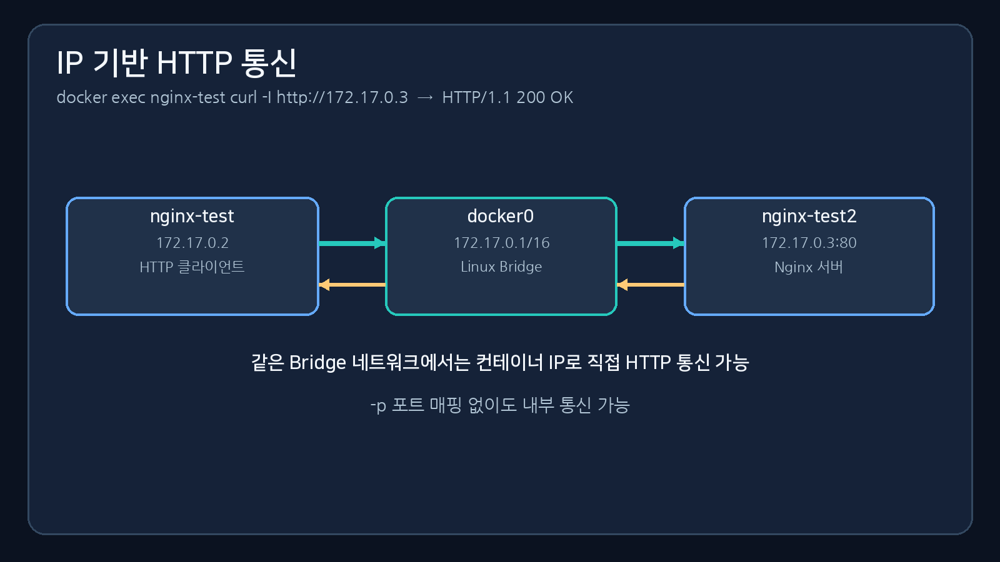
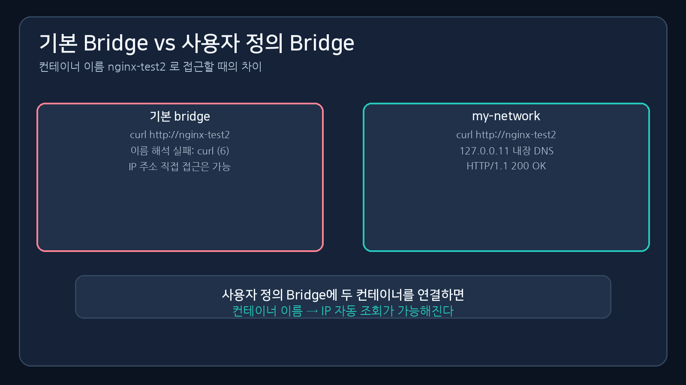
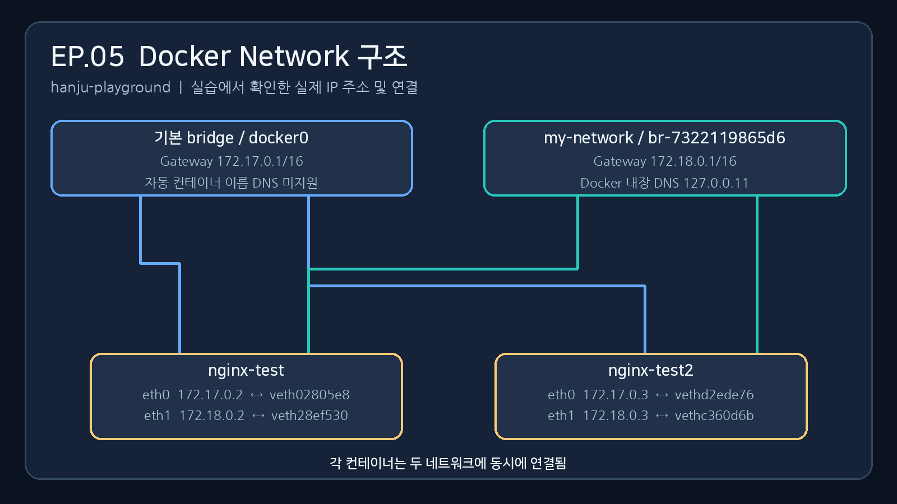

## Prologue

ㅇㅋ 이번에는 컨테이너의 네트워크를 공부하자

실습 환경:

| 항목 | 값 |
|---|---|
| OS | Rocky Linux 9.8 |
| Docker Host | `hanju-playground` |
| Host NIC | `ens192` / `10.129.1.149/24` |
| Host Gateway | `10.129.1.1` |
| Docker Image | `nginx:stable` |
| 컨테이너 | `nginx-test`, `nginx-test2` |


## 1. Docker를 실행하면 docker0가 생긴다

```bash
systemctl status docker
docker network ls
ip addr show docker0
```

기본 네트워크 목록:

```text
NETWORK ID     NAME      DRIVER    SCOPE
972607fe6047   bridge    bridge    local
2029d046677d   host      host      local
31a27359a0a4   none      null      local
```

기본 Bridge 확인:

```text
docker0: <BROADCAST,MULTICAST,UP,LOWER_UP> ... state UP
    inet 172.17.0.1/16
```

Docker Engine RPM 설치 **자체**보다는 Docker 데몬(`dockerd`)이 기본 Bridge 네트워크를 초기화할 때 (systemctl start 때릴때)
Linux Bridge 인터페이스 `docker0`가 생성됨.

- `bridge`: Docker가 관리하는 **기본 네트워크 이름**
- `docker0`: 기본 `bridge`를 구현한 **Linux Bridge 인터페이스 이름**
- `veth`: 컨테이너의 네트워크 인터페이스와 호스트 Bridge를 연결하는 **가상 Ethernet 쌍**

기본 Bridge에서는 보통 `172.17.0.0/16`이 사용되지만, 설정 및 주소 충돌 여부에 따라 달라질 수 있음.

```bash
docker network inspect bridge
```

관찰한 주요 설정:

```json
"Subnet": "172.17.0.0/16",
"Gateway": "172.17.0.1"
```

## 2. 컨테이너를 실행하면 veth가 연결된다

```bash
docker start nginx-test
ip -br link
bridge link
```

실습 결과:

```text
veth02805e8@if2    UP ...
22: veth02805e8@ens192: ... master docker0 state forwarding
```

`master docker0`는 **해당 veth 인터페이스가 Linux Bridge `docker0`에 연결되어 있으며, `docker0`를 통해 다른 컨테이너 및 호스트와 통신할 수 있다**는 의미이다.

-> `docker0`는 컨테이너들의 네트워크를 연결하는 가상 스위치 역할을 한다.

`@ens192` 표시만 보고 veth가 물리 NIC에 직접 붙은게 아님.

해당 표시는 peer 인터페이스 인덱스를 호스트의 네임스페이스에서 이름으로 해석해 보이는 경우가 있음

컨테이너가 종료되어 활성 포트가 없을 때는 `docker0`가 `NO-CARRIER`, `state DOWN`으로 표시되고, 컨테이너를 다시 기동하묜 `LOWER_UP`, `state UP`로 바뀜.

### 호스트와 컨테이너의 라우팅

호스트에서 확인:

```bash
ip route
```

```text
default via 10.129.1.1 dev ens192
10.129.1.0/24 dev ens192 src 10.129.1.149
172.17.0.0/16 dev docker0 src 172.17.0.1
```

컨테이너 내부의 네트워크 네임스페이스는
호스트와 별도의 네트워크 인터페이스 및 라우팅 테이블을 가진다.

```bash
nsenter -t $(docker inspect -f '{{.State.Pid}}' nginx-test) -n ip -br addr
```

## 3. Nginx 컨테이너 두 개로 IP 통신

```bash
docker run -d --name nginx-test2 nginx:stable
```
IP 확인:

```bash
docker network inspect bridge
```

```text
nginx-test     172.17.0.2/16
nginx-test2    172.17.0.3/16
```


_Docker 기본 Bridge를 통한 HTTP 통신_

nginx-test에서 nginx-test2 Nginx로 요청했다.

```bash
docker exec nginx-test curl -I http://172.17.0.3
```

```text
HTTP/1.1 200 OK
Server: nginx/1.30.6
```

성공> `nginx-test2`는 `-p` 옵션을 사용하지 않았는데도 통신이 된다. **`-p`는 호스트 포트를 컨테이너 포트에 게시하는 기능**
-> (같은 Bridge에 연결된 컨테이너끼리 IP로 통신할 때 필수는 아님)

`nginx-test`의 `127.0.0.1:8080->80/tcp`는 호스트의 loopback 주소에만 바인딩한 포트 매핑이다.


## 4. 컨테이너 이름으로 접근

```bash
docker exec nginx-test curl -I http://nginx-test2
```

```text
curl: (6) Could not resolve host: nginx-test2
```

같은 기본 `bridge` 네트워크에서는 컨테이너 이름을 자동으로 DNS로 매핑해서 조회 하지 않음

**IP로 통신이 되는 것과 이름을 IP로 해석하는 건 다름**


_기본 Bridge의 이름 조회 실패와 사용자 정의 Bridge의 성공 비교_

## 5. 사용자 정의 Bridge 생성

```bash
docker network create --driver bridge my-network
docker network connect my-network nginx-test
docker network connect my-network nginx-test2
```

`connect`는 기본 Bridge를 제거하지 않고 **기존 컨테이너에 네트워크를 추가**

다시 이름으로 접근하면:

```bash
docker exec nginx-test curl -I http://nginx-test2
```

```text
HTTP/1.1 200 OK
Server: nginx/1.30.6
```

정상 성공했고, DNS 파일도 달라짐.

```bash
docker exec nginx-test cat /etc/resolv.conf
```

```text
nameserver 127.0.0.11
options ndots:0
```

`127.0.0.11`은 Docker가 사용자 정의 네트워크에 제공하는 **내장 DNS resolver**다.

-> 같은 네트워크의 컨테이너 이름을 IP로 해석할 수 있다. 
(외부 DNS 주소만 수동으로 추가해도 기본 Bridge에 이런 자동 이름 등록 기능이 생기는건 아님)

## 6. 두 네트워크에 동시에 연결된 컨테이너


_실제 IP, 게이트웨이, veth pair를 반영한 최종 네트워크 구성도_

새 네트워크의 주소:

```bash
docker network inspect -f '{{range .IPAM.Config}}{{.Subnet}} Gateway={{.Gateway}}{{end}}' my-network
```

```text
172.18.0.0/16 Gateway=172.18.0.1
```

호스트 측 연결:

```bash
bridge link
```

```text
veth02805e8  master docker0
vethd2ede76  master docker0
veth28ef530  master br-7322119865d6
vethc360d6b  master br-7322119865d6
```

컨테이너 내부 인터페이스:

```bash
nsenter -t $(docker inspect -f '{{.State.Pid}}' nginx-test) -n ip -br addr
nsenter -t $(docker inspect -f '{{.State.Pid}}' nginx-test2) -n ip -br addr
```

```text
# nginx-test
eth0@if22    UP    172.17.0.2/16
eth1@if37    UP    172.18.0.2/16

# nginx-test2
eth0@if35    UP    172.17.0.3/16
eth1@if38    UP    172.18.0.3/16
```

컨테이너 2개 × 네트워크 2개 = **호스트 측 veth 인터페이스 4개**가 출력됨

| 컨테이너 | 기본 `bridge` | `my-network` |
|---|---|---|
| `nginx-test` | eth0 / 172.17.0.2 | eth1 / 172.18.0.2 |
| `nginx-test2` | eth0 / 172.17.0.3 | eth1 / 172.18.0.3 |

이름 기반 통신을 위해 반드시 네트워크를 **추가**해야 하는건 아니다. 처음부터 그냥 `docker run --network my-network`를 사용하면 됨. 앞으론 그렇게 만들어보자ㅇㅇ

## 7. 정리

정리맨

1. Docker 데몬은 기본 `bridge` 및 `docker0`를 초기화한다.
2. 컨테이너는 veth pair를 통해 Linux Bridge에 연결된다.
3. 같은 Bridge의 컨테이너들은 IP로 통신할 수 있다.
4. 기본 Bridge에서는 이름 조회가 자동 제공되지 않는다.
5. 사용자 정의 Bridge는 내장 DNS를 제공하므로 컨테이너 이름으로 통신할 수 있다.
6. 하나의 컨테이너는 여러 Docker 네트워크에 동시에 연결될 수 있다.


---

**참고:** [Docker Docs — Bridge network driver](https://docs.docker.com/engine/network/drivers/bridge/)
